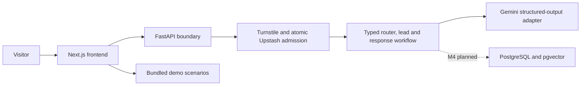

# AgentFlow architecture

The foundation uses a Next.js frontend and a modular FastAPI backend. The health API is always available; the live chat route is opt-in and protected by server-side admission. See LIVE.md for current limits and pending release gates.

The browser is untrusted. Provider credentials and database credentials remain server-side. Client conversation history and retrieved documents are data, never authoritative instructions. Operational traces contain allowlisted metadata, never private model reasoning.

The database baseline installs pgvector and creates versioned document metadata with RLS enabled and forced. It intentionally has no public policies or application grants. The local database owner is a development/migration identity, not the future deployed runtime role. No runtime database access exists yet. The embedding spike returned 768 dimensions. Chunk storage, ingestion, retrieval and least-privilege runtime grants remain M4 work.

Cloud services are optional for foundation development. The offline demo uses bundled fixtures and never calls the backend; the backend health check needs no external dependencies. Docker Compose provides PostgreSQL and Redis for upcoming integration work. Backend and database startup do not automatically run migrations.

Dependency versions are locked separately for Node and Python. Python runtime dependencies and development dependencies have separate hash-checked locks. Container tags must be resolved to reviewed digests before public deployment.

## Offline demo implementation

`frontend/app/demo/page.tsx` reads six allowlisted Markdown documents at build time and passes them with the canonical scenario fixtures to a client component. `/demo` is statically prerendered. Scenario execution, source selection, and reset use component state only. The application does not persist selections or request live model output. Citation excerpts are checked against their canonical documents by the prebuild test suite. All text is escaped by React; no HTML or Markdown execution is enabled.
